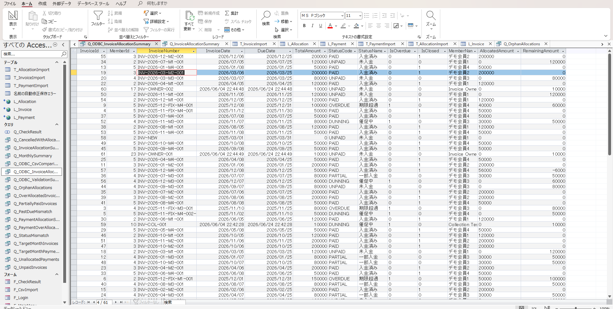
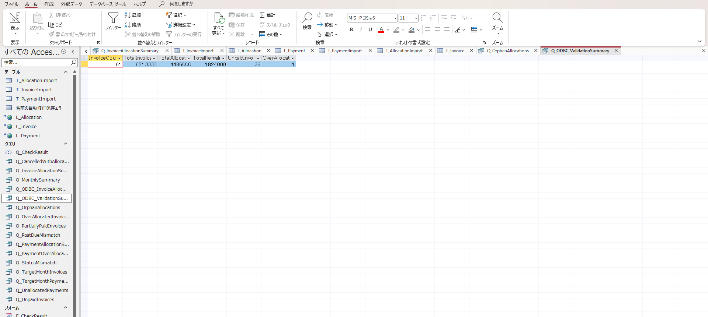
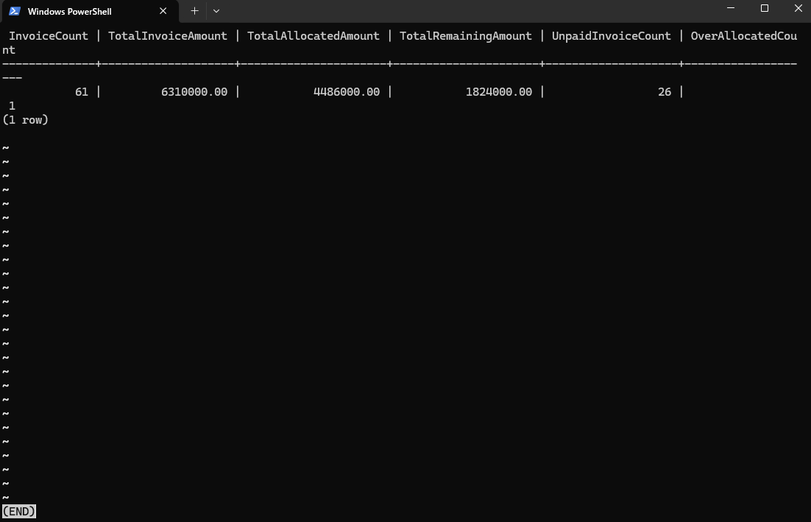
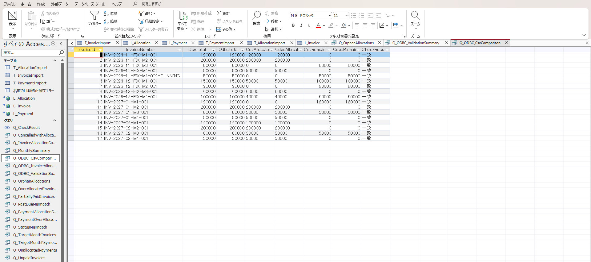
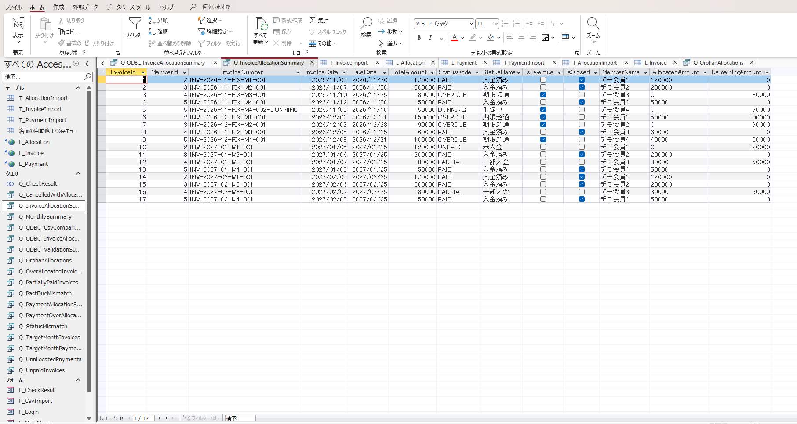

# Phase 2：PostgreSQL ODBC読取専用連携・照合検証

> 対象：Invoice Access Operations Tool / ローカル検証（2026年10月）
>
> Phase 1のAPI/ZIP/CSV連携を変更せず、Phase 2で参照用のODBC経路を追加した実装・検証記録。

## 1. 目的と責務境界

- Invoice Management Systemを正データの管理主体とする。
- Phase 1はJWT認証を経由したAPIから3CSVを取得・保存し、AccessのImport Tableで月次照合する。
- Phase 2はPostgreSQLのViewを、専用ロールで**参照だけ**行う。ODBC側から元テーブルの更新や請求・入金登録をしない。
- 異なる経路で集計した金額を比較することが狙いであり、CSVの業務フロー自体をODBCへ置き換えない。

## 2. 検証環境

| 項目 | 取得・確認した内容 |
|---|---|
| PostgreSQL | PostgreSQL 16、Dockerローカル |
| ODBC検証DB | `invoice_postgres` / `invoicesystem` / localhost:5432 |
| 初期接続用DB（別インスタンス） | `invoice-system-postgres` / localhost:5433 / 0件 |
| DBロール | `access_readonly`（専用） |
| ODBC | PostgreSQL Unicode(x64) / psqlODBC |
| 開発用DSN | `InvoiceAccessDataLocal` |
| Access | `InvoiceAccessOperations.accdb` |
| 元テーブル件数 | Invoice 61 / Payment 108 / Allocation 58 |

ポート5432は検証時に `0.0.0.0:5432` で公開されていた。これはループバック以外のインターフェースからも接続を受け付け得る設定である。**この設定を `127.0.0.1:5432:5432` に変更・反映したことは本記録では未確認**のため、ローカル検証用Composeの公開範囲を確認・制限することを残課題とする。**本番VPSのDBポートを外部公開しない。**

## 3. 構成

```text
PostgreSQL（invoicesystem）
  ├─ public."Invoices"
  ├─ public."InvoiceStatuses"
  ├─ public."Members"
  ├─ public."Payments"
  └─ public."PaymentAllocations"
           ↓ 参照用View
  access_reporting.v_invoice_read
  access_reporting.v_payment_read
  access_reporting.v_allocation_read
           ↓ ODBC / access_readonly（SELECTのみ）
  Microsoft Access
  ├─ L_Invoice
  ├─ L_Payment
  ├─ L_Allocation
  ├─ Q_ODBC_InvoiceAllocationSummary
  ├─ Q_ODBC_ValidationSummary
  └─ Q_ODBC_CsvComparison

別経路：ASP.NET Core API → 3CSV → T_*Import → Q_InvoiceAllocationSummary
```

## 4. View仕様

| PostgreSQL View | SELECT対象 | Access側リンク |
|---|---|---|
| `v_invoice_read` | `Invoices` LEFT JOIN `InvoiceStatuses` / `Members` | `L_Invoice` |
| `v_payment_read` | `Payments` | `L_Payment` |
| `v_allocation_read` | `PaymentAllocations` | `L_Allocation` |

`v_invoice_read` は`InvoiceId`, `MemberId`, `InvoiceNumber`, `InvoiceDate`, `DueDate`, `TotalAmount`, `StatusId`, `StatusCode`, `StatusName`, `IsOverdue`, `IsClosed`, `MemberName`を返す。`Q_ODBC_InvoiceAllocationSummary`で`AllocatedAmount`と`RemainingAmount`を算出し、既設の13項目と列構成を揃える。

ViewのSQLおよび権限付与例は [`03_detail_design.md`](03_detail_design.md) の「71. Phase 2」を参照。DDLは本体テーブルの構造変更ではなく、別スキーマにViewを追加する操作である。

## 5. DB権限の制約

- `access_readonly` に `CONNECT`（DB）、`USAGE`（access_reporting）、3つのViewの `SELECT` を付与する。
- Viewへの `INSERT` / `UPDATE` / `DELETE` と、元テーブルへの直接 `SELECT` は付与しない。
- PostgreSQLのViewが単純な構造の場合は書込み可能な場合があるため、**DBロールの権限で必ず制限する**。
- 新しい接続先では`has_table_privilege`による権限確認を実施し、ロールが意図しない追加の権限を継承していないか確認する。
- `\password access_readonly`でパスワードを対話設定し、平文パスワードやJWTをファイル・画像へ残さない。

## 6. Access側の実装

| クエリ | 内容 |
|---|---|
| `Q_ODBC_InvoiceAllocationSummary` | `L_Invoice` と `L_Allocation` のLEFT JOIN、InvoiceIdでGROUP BY、割当・残額の計算 |
| `Q_ODBC_ValidationSummary` | 6指標を1レコードに集約 |
| `Q_ODBC_CsvComparison` | CSV側17件を起点に、ODBCの同じInvoiceIdへLEFT JOINし、金額3項目比較 |

SQL本文は [`03_detail_design.md`](03_detail_design.md) の「71.4〜71.6」を参照。

## 7. 動作確認結果

| 検証指標 | Access ODBC | PostgreSQL | 結果 |
|---|---:|---:|---|
| InvoiceCount | 61 | 61 | 一致 |
| TotalInvoiceAmount | 6,310,000 | 6,310,000 | 一致 |
| TotalAllocatedAmount | 4,486,000 | 4,486,000 | 一致 |
| TotalRemainingAmount | 1,824,000 | 1,824,000 | 一致 |
| UnpaidInvoiceCount（残額が正） | 26 | 26 | 一致 |
| OverAllocatedCount（残額が負） | 1 | 1 | 一致 |

CSV側17件との照合は **17件すべて一致・差異0件**。比較項目は `TotalAmount`, `AllocatedAmount`, `RemainingAmount` の3つ。CSV側17件とODBC側61件の母集団は一致していないので、**CSV側の17件についてのみ検証完了**とする。

## 8. エビデンス（動確エビデンス20261012）

| 画像 | 内容 |
|---|---|
|  | 13項目の請求照合結果（ODBC、61件） |
|  | Access `Q_ODBC_ValidationSummary` の6項目 |
|  | PostgreSQL側のSQL結果 |
|  | CSV17件の比較結果：「一致」17件 |
|  | 比較元の既設CSVクエリ（17件） |

## 9. 公開前のセキュリティ確認（2026年10月）

`InvoiceAccessOperations.accdb` のGitHub公開に向け、次の項目を確認した。**ODBCリンクテーブルの検査結果はVBAによる実行結果**、その他は開発者による内容確認に基づく。

| 確認対象 | 結果 | 確認内容・範囲 |
|---|---|---|
| `L_Invoice` | 確認済み | `PasswordKey=False` / `SavePWD=False` |
| `L_Payment` | 確認済み | `PasswordKey=False` / `SavePWD=False` |
| `L_Allocation` | 確認済み | `PasswordKey=False` / `SavePWD=False` |
| VBAコード | 確認済み | パスワード・JWTなどの秘密情報の直書きなし（開発者確認） |
| `F_Login` | 確認済み | 入力欄の既定値は空欄（開発者確認） |
| 取込テーブル | 確認済み | 取り込んだデータはダミーデータ（開発者確認） |
| 過去のGitコミット | 確認済み | 秘密情報なし（開発者確認） |
| Windows側ODBC DSN | 未確認 | レジストリ等にパスワードが保存されていないかの確認は未完了 |

上記のVBA検査では、ODBCリンクの接続文字列に一般的なパスワード・トークンのキーがないこと、およびAccessの `dbAttachSavePWD` 属性が無効であることを確認した。**この検査だけでACCDB内のあらゆる秘密情報の不存在まで保証するものではない。**

WindowsのDSN設定は通常 `.accdb` へ同梱されないが、**DSN側にパスワードが保存されている場合はローカルPCの認証情報管理として別途対処する**。GitHubへ配布する際も、接続先DSNは閲覧者の環境で設定する前提とする。

上記の確認範囲では、今回のODBC追加に起因する秘密情報保存の問題は見つかっていない。公開前にACCDB本体およびステージング済みファイルを改めて確認する。

## 10. 制約と残課題

- 日付やステータス、請求番号、会員名の値まで等しいことは今回の比較では検証していない。
- CSVの取得時点とODBCの参照時点が厳密に同一であることも未確認。
- ODBCは全件直接参照、API/CSVは指定対象月までの累積データを抽出する。共通InvoiceId以外の直接比較は対象集合を揃える必要がある。
- APIの過去月基準は割当履歴を完全に再現するものではない。新たな会計スナップショット機能を実装したわけではない。
- ODBCの本番接続・5432側の明示的なUPDATE拒否操作・大量データ性能/障害系試験は別課題とする。
- `invoice_postgres` のポート5432の公開範囲制限、およびWindows側DSNのパスワード保存有無の確認は別途実施する。

## 11. 関連資料

- [`01_requirements.md`](01_requirements.md) — Phase 2追加要件
- [`02_basic_design.md`](02_basic_design.md) — Phase 2基本設計
- [`03_detail_design.md`](03_detail_design.md) — View/権限とAccess SQLの詳細
- [`../README.md`](../README.md) — 機能・エビデンス概要
