# Phase 3：読取専用権限・Access異常系テスト記録

> 対象：Invoice Access Operations Tool／ローカル検証（2026年10月15日まで）  
> Phase 1のAPI/ZIP/CSV取込、Phase 2のPostgreSQL ODBC参照・集計比較に対する**追加の検証記録**。実装機能を追加した記録ではない。

## 1. 目的と判定範囲

- PostgreSQL `access_readonly` のView参照許可、元テーブル書込拒否を検証する。
- Accessの既設クエリで意図的な異常データを抽出できるか、正常状態と境界値も含めて検証する。
- リポジトリの正式 `.accdb`、ODBCリンク先のDB元データは変更しない。Accessのテスト用コピーの**インポート済みダミーデータのみ**を変更し、復元を確認する。
- ローカル検証の対象外（ODBC実ログインでの更新拒否、本番環境、障害・性能試験、固定基準日の業務妥当性）を明記する。

## 2. 検証環境・安全策

| 項目 | 内容 |
|---|---|
| PostgreSQL | Docker `invoice_postgres` / PostgreSQL 16 / `invoicesystem` / localhost:5432 |
| 権限ロール | `access_readonly` |
| 参照View | `access_reporting.v_invoice_read` |
| Access | Microsoft Access / `Q_PaymentOverAllocation`, `Q_StatusMismatch`, `Q_CancelledWithAllocation`, `Q_PastDueMismatch` |
| コピー元（変更しない） | `access/InvoiceAccessOperations.accdb` |
| コピー先（検証用） | `%TEMP%\InvoiceAccessOperations-Phase3-Test.accdb` |
| データ | ダミーCSV取込データ。更新は `T_InvoiceImport` / `T_PaymentImport` のみ |

Access終了後、必要に応じて検証用コピーを作成する。

```powershell
Copy-Item ".\access\InvoiceAccessOperations.accdb" "$env:TEMP\InvoiceAccessOperations-Phase3-Test.accdb"
Invoke-Item "$env:TEMP\InvoiceAccessOperations-Phase3-Test.accdb"
```

検証中は `L_Invoice` / `L_Payment` / `L_Allocation` に対する更新処理、元DBへのINSERT/UPDATE/DELETE、CSVの再取込を行わない。

## 3. PostgreSQL読取専用権限の検証

### 3.1 権限マトリクス

`postgres` のpsqlセッションで `has_table_privilege` により `access_readonly` を評価する。

| 権限判定 | 実測 | 期待 | 判定 |
|---|---|---|---|
| View SELECT | `t` | 許可 | 合格 |
| View UPDATE | `f` | 拒否 | 合格 |
| 元テーブル `public."Invoices"` SELECT | `f` | 拒否 | 合格 |
| 元テーブル `public."Invoices"` UPDATE | `f` | 拒否 | 合格 |
| 元テーブル `public."Invoices"` DELETE | `f` | 拒否 | 合格 |

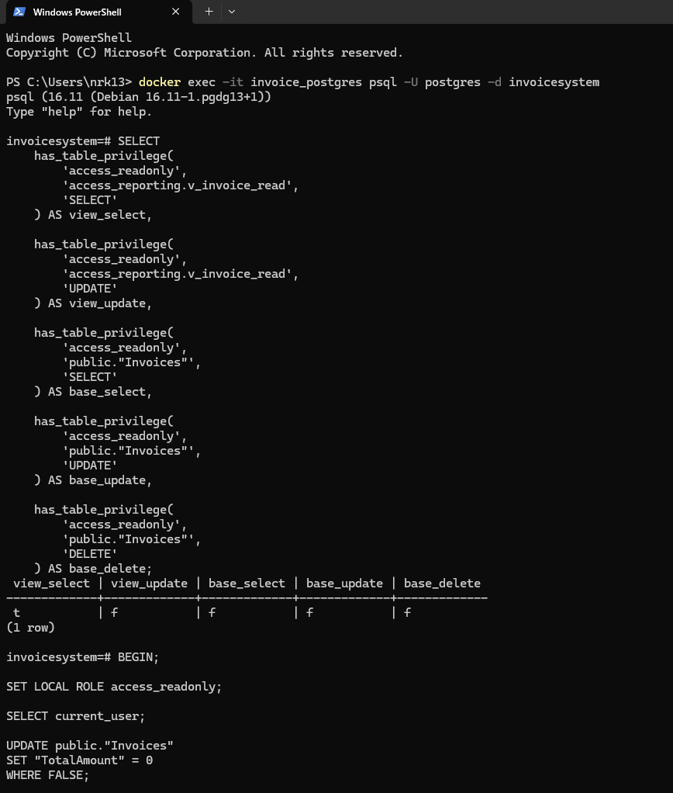

### 3.2 ロール切替による実操作

```sql
BEGIN;
SET LOCAL ROLE access_readonly;
SELECT current_user;
UPDATE public."Invoices" SET "TotalAmount" = 0 WHERE FALSE;
ROLLBACK;
```

```sql
BEGIN;
SET LOCAL ROLE access_readonly;
DELETE FROM public."Invoices" WHERE FALSE;
ROLLBACK;
```

**実測：** `current_user = access_readonly`。UPDATEとDELETEがいずれも `ERROR: permission denied for table Invoices` で失敗した。`WHERE FALSE` により更新対象0件、各回 `ROLLBACK` も実行して元データを維持した。

### 3.3 Viewの読取成功

```sql
BEGIN;
SET LOCAL ROLE access_readonly;
SELECT COUNT(*) AS invoice_count
FROM access_reporting.v_invoice_read;
ROLLBACK;
```

**実測：61件（期待61件）、合格。**

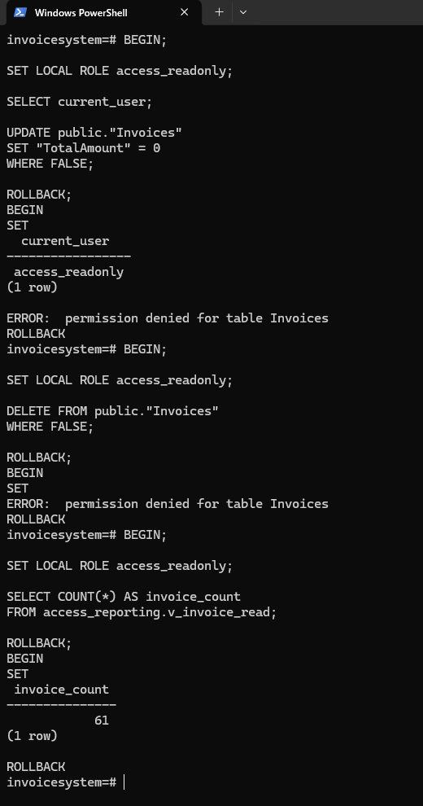

**検証範囲の注記：** ローカルの管理者セッションで `SET LOCAL ROLE` を用いたため、これはロールの権限検証であり、ODBCから当該アカウントで再ログインした操作検証ではない。また本番VPSに対して更新操作を試したものではない。

## 4. Access照合クエリの異常系検証

### 4.1 Q_PaymentOverAllocation（入金額を超える割当）

対象PaymentId=1。正常時 `PaymentAmount=120000`、`AllocatedAmount=120000`、`UnallocatedAmount=0`。`AllocatedAmount > PaymentAmount` の条件を検証した。

| ケース | PaymentAmount | AllocatedAmount | 結果 | 判定 |
|---|---:|---:|---|---|
| 正常 | 120,000 | 120,000 | 0件 | 合格 |
| 異常 | 119,000 | 120,000 | 1件、未割当額 -1,000円 | 合格 |
| 境界値 | 119,999 | 120,000 | 1件、未割当額 -1円 | 合格 |

実施した更新（検証用ACCDBの `T_PaymentImport` のみ）：

```sql
UPDATE T_PaymentImport
SET [Amount] = 119000
WHERE [PaymentId] = 1 AND [Amount] = 120000;
```

```sql
UPDATE T_PaymentImport
SET [Amount] = 119999
WHERE [PaymentId] = 1 AND [Amount] = 119000;
```

復元：

```sql
UPDATE T_PaymentImport
SET [Amount] = 120000
WHERE [PaymentId] = 1 AND [Amount] = 119999;
```

| 証跡 | 内容 |
|---|---|
| 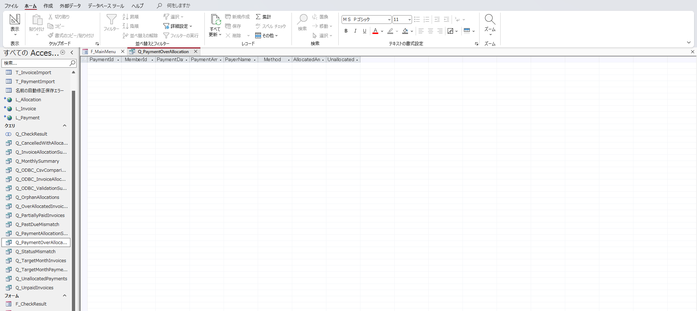 | `Q_PaymentOverAllocation` の異常投入前0件 |
| 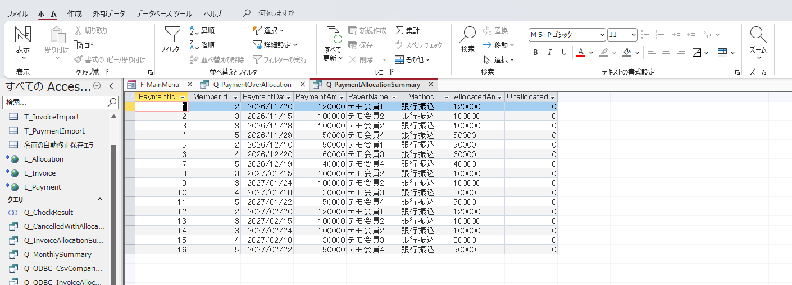 | `Q_PaymentAllocationSummary`、16件の入金・割当サマリー |
| 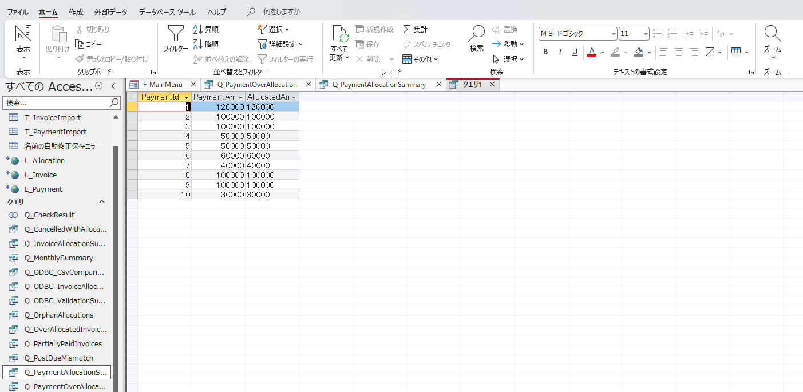 | 変更前の金額一致データ10件 |
| 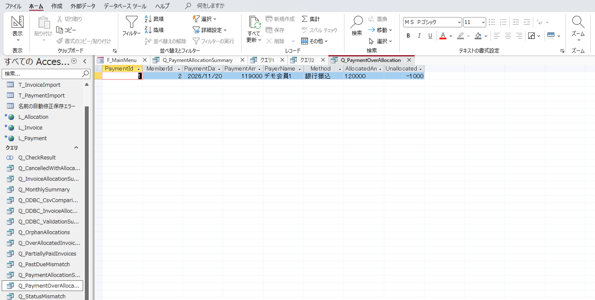 | PaymentId=1の過剰額1,000円 |
| 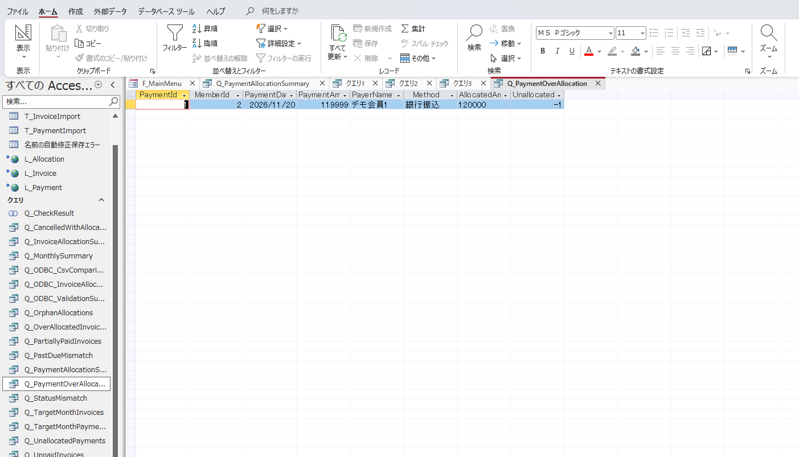 | 1円の境界値を検出 |

### 4.2 Q_StatusMismatch（登録ステータスと計算結果）

**正常時の不一致件数は0件。** 判定式は以下の分類を使用する（正の請求額、非負の割当を前提）。

| 計算条件 | `CalculatedStatus` |
|---|---|
| 割当0 | UNPAID |
| 0より大きく請求額未満 | PARTIAL |
| 請求額と一致 | PAID |
| 請求額より大きい | OVER_ALLOCATED |

| 異常パターン | InvoiceId | 金額（請求／割当） | 登録 `StatusCode` | `CalculatedStatus` | 結果 |
|---|---:|---|---|---|---|
| 全額入金済みなのに未入金 | 1 | 120,000／120,000 | UNPAID | PAID | 1件検出、合格 |
| 未入金なのに入金済み | 10 | 120,000／0 | PAID | UNPAID | 1件検出、合格 |
| 一部入金なのに全額入金済み | 12 | 80,000／30,000 | PAID | PARTIAL | 1件検出、合格 |

```sql
-- ケース1：PAID → UNPAID
UPDATE T_InvoiceImport SET StatusCode='UNPAID'
WHERE InvoiceId=1 AND StatusCode='PAID';
-- 復元
UPDATE T_InvoiceImport SET StatusCode='PAID'
WHERE InvoiceId=1 AND StatusCode='UNPAID';
```

```sql
-- ケース2：UNPAID → PAID
UPDATE T_InvoiceImport SET StatusCode='PAID'
WHERE InvoiceId=10 AND StatusCode='UNPAID';
-- 復元
UPDATE T_InvoiceImport SET StatusCode='UNPAID'
WHERE InvoiceId=10 AND StatusCode='PAID';
```

```sql
-- ケース3：PARTIAL → PAID
UPDATE T_InvoiceImport SET StatusCode='PAID'
WHERE InvoiceId=12 AND StatusCode='PARTIAL';
-- 復元
UPDATE T_InvoiceImport SET StatusCode='PARTIAL'
WHERE InvoiceId=12 AND StatusCode='PAID';
```

| 証跡 | 内容 |
|---|---|
| 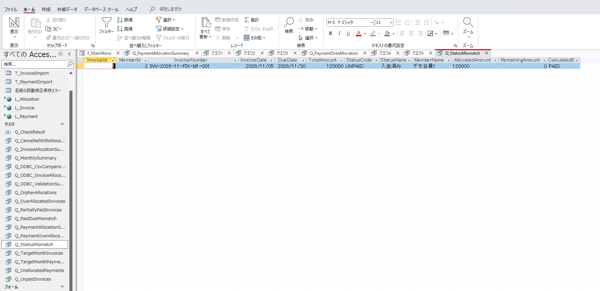 | `StatusCode=UNPAID` と `CalculatedStatus=PAID` |
| 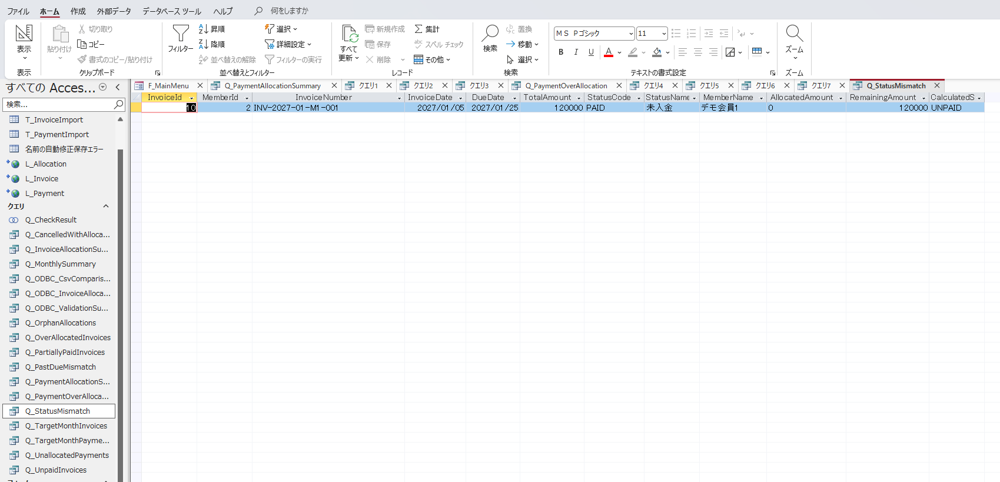 | `StatusCode=PAID` と `CalculatedStatus=UNPAID` |
| 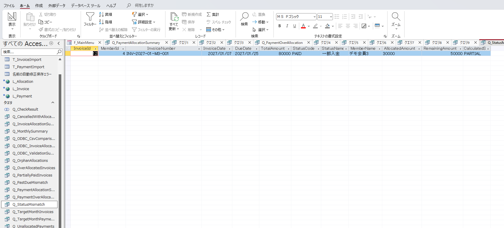 | `StatusCode=PAID` と `CalculatedStatus=PARTIAL` |

**注意：** `StatusName` は変更せず `StatusCode` だけを一時変更した。これは既存照合クエリの判定ロジックを検証する手段であり、名称とコードの整合性を別途保証する試験ではない。復元は開発者が完了を確認した。

### 4.3 Q_CancelledWithAllocation（取消済み請求への入金割当）

`StatusCode='CANCELLED' AND AllocatedAmount>0` を検証する。対象InvoiceId=12は正常時 `PARTIAL`、割当30,000円。

```sql
UPDATE T_InvoiceImport SET StatusCode='CANCELLED'
WHERE InvoiceId=12 AND StatusCode='PARTIAL';
```

**結果：** InvoiceId=12、請求80,000円、割当30,000円が1件検出された（合格）。

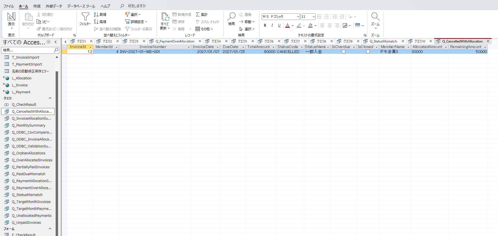

```sql
UPDATE T_InvoiceImport SET StatusCode='PARTIAL'
WHERE InvoiceId=12 AND StatusCode='CANCELLED';
```

変更前0件、異常時1件、復元後0件（開発者確認）。

### 4.4 Q_PastDueMismatch（期日超過フラグの不一致）

**本項は固定基準日のままのクエリ動作検証であり、業務上の期日超過状態が正しいと認定するものではない。**

現行判定式：

```sql
IIf(
    Q.DueDate < #2026/10/01#
    AND Q.AllocatedAmount < Q.TotalAmount,
    True,
    False
)
```

現状、2026年11月～12月を期日とする請求でも `IsOverdue=True` が設定されており、2026/10/01の比較式で再計算するとFalseになる。このため**異常投入前から5件**を抽出する。

| ケース | InvoiceId | `IsOverdue` | `CalculatedIsOverdue` | クエリ件数 |
|---|---:|---|---|---:|
| 元データ（基準） | — | 既存値 | — | 5 |
| フラグ変更 | 10 | True | False | 6 |
| 復元 | 10 | False | False | 5（開発者確認） |

```sql
UPDATE T_InvoiceImport SET IsOverdue=True
WHERE InvoiceId=10 AND IsOverdue=False;
```

```sql
UPDATE T_InvoiceImport SET IsOverdue=False
WHERE InvoiceId=10 AND IsOverdue=True;
```

| 証跡 | 内容 |
|---|---|
| 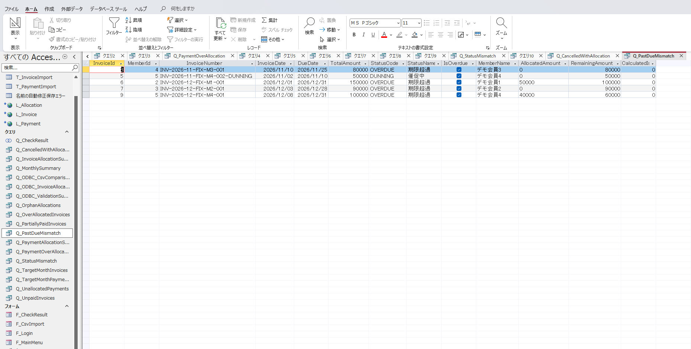 | 基準件数5（InvoiceId 3, 5, 6, 7, 9） |
| 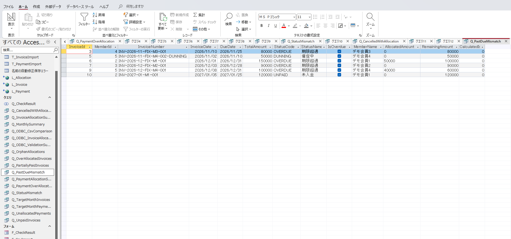 | 追加InvoiceId=10で計6件、`CalculatedIsOverdue=False` |

## 5. テスト結果サマリー

| テスト群 | 結果 | 備考 |
|---|---|---|
| PostgreSQL権限マトリクス | 合格 | View SELECTと元Invoicesへのアクセス制限を確認 |
| PostgreSQL更新・削除拒否 | 合格 | ロール切替、`WHERE FALSE`、ROLLBACK |
| Viewの61件取得 | 合格 | access_readonly権限で取得 |
| 入金過剰割当（1,000円） | 合格 | PaymentId=1 |
| 入金過剰割当（境界1円） | 合格 | PaymentId=1 |
| ステータス不一致（3ケース） | 3件とも合格 | 各ケースを個別に投入し1件ずつ抽出 |
| キャンセル済み請求への割当 | 合格 | InvoiceId=12 |
| 期日超過フラグ不一致 | 合格 | 5→6→5、ただし固定基準日あり |
| テストデータの復元 | 完了 | リポジトリ内の正式ACCDBは検証用更新対象外 |

### 完了判定

本Phase 3の**限定されたローカル権限・異常系検証は完了**とする。全機能の結合試験・性能試験・業務ルールの網羅性を主張するものではない。

## 6. 既知の課題・未検証項目

1. `Q_PastDueMismatch` の基準日 `#2026/10/01#` が固定。照合対象年月の月末日やExport実行時点など、何を評価基準とするかの仕様を明確化する必要がある。既存5件は原因分析・期待値再設定が別途必要。
2. `StatusCode` と `StatusName` の整合性は、今回StatusCodeのみ更新したため検証対象外。
3. ODBCによる実際の認証セッションでUPDATE/DELETEが拒否されることや、本番VPS接続については未検証（ローカルDB権限の `SET LOCAL ROLE` 検証のみ）。
4. 入金・請求の外部キー孤児、マイナス・NULL・ゼロ請求、CSVフォーマット異常、取込失敗／途中復旧、同時更新、大量データなどの網羅的な試験は未実施。
5. Windows DSNのパスワード保存有無と、ローカル5432番ポートの公開範囲は別途確認する（Phase 2での残課題）。
6. 復元後の各クエリの件数は開発者の確認に基づき、復元時の全画面証跡が添付されているわけではない。

## 7. エビデンスファイル一覧

画像は [`images/`](images/) 配下の `18` ～ `30` を参照。**すべて提供された「動確エビデンス20261015.zip」から採用した画像**であり、検証結果を新たに生成したものではない。

| ファイル名 | 内容 |
|---|---|
| `18-phase3-db-privileges.png` | PostgreSQL `has_table_privilege` |
| `19-phase3-db-denial.png` | UPDATE/DELETE拒否、View SELECT成功 |
| `20-phase3-payment-overallocation-baseline.png` | 過剰割当：正常0件 |
| `21-phase3-payment-summary.png` | 入金・割当サマリー16件 |
| `22-phase3-payment-targets.png` | テスト入金候補10件 |
| `23-phase3-payment-overallocation-1000.png` | 1,000円過剰割当 |
| `24-phase3-payment-overallocation-1.png` | 1円過剰割当 |
| `25-phase3-status-paid-as-unpaid.png` | 全額入金済み→UNPAID |
| `26-phase3-status-unpaid-as-paid.png` | 未入金→PAID |
| `27-phase3-status-partial-as-paid.png` | 一部入金→PAID |
| `28-phase3-cancelled-allocation.png` | キャンセル済み請求への割当 |
| `29-phase3-overdue-before.png` | 期日超過不一致：元から5件 |
| `30-phase3-overdue-after.png` | 期日超過不一致：追加後6件 |

## 8. 関連資料

- [`01_requirements.md`](01_requirements.md) — Phase 3の検証要件
- [`02_basic_design.md`](02_basic_design.md) — テスト方針・ケース設計
- [`03_detail_design.md`](03_detail_design.md) — 更新・復元SQLとPostgreSQL検証SQL
- [`04_odbc_readonly.md`](04_odbc_readonly.md) — Phase 2の元のODBC設計・制約
- [`../README.md`](../README.md) — 全体構成と実装状況


---

## 9. 後続対応：Phase 4

本書の `Q_PastDueMismatch` に関する固定基準日 `#2026/10/01#`・元5件という記載は**Phase 3実施当時の結果**として保持する。後続のPhase 4では、対象月末を動的に算出する `Q_PastDueAsOfMonth` と `Q_PastDueMismatchAsOfMonth` を追加し、2027年2月のダミーデータで新基準の不一致3件を確認した。比較基準の変更であり、Phase 3の結果を書き換えるものではない。詳細は [`06_phase4_pastdue.md`](06_phase4_pastdue.md)。
