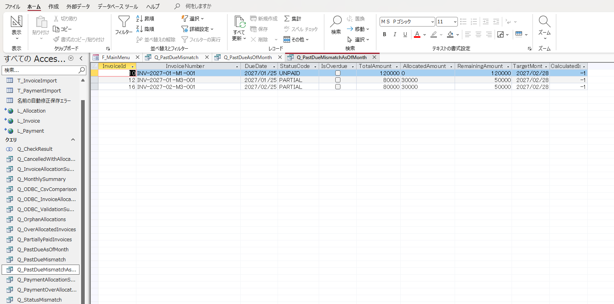
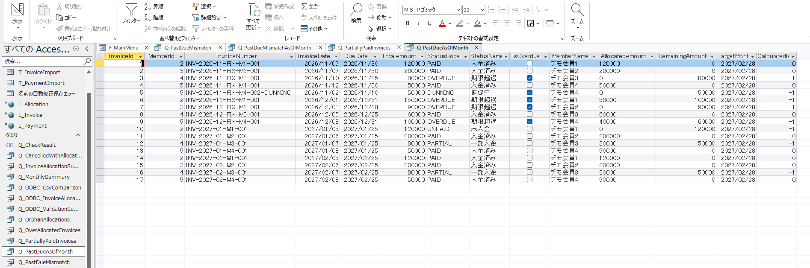
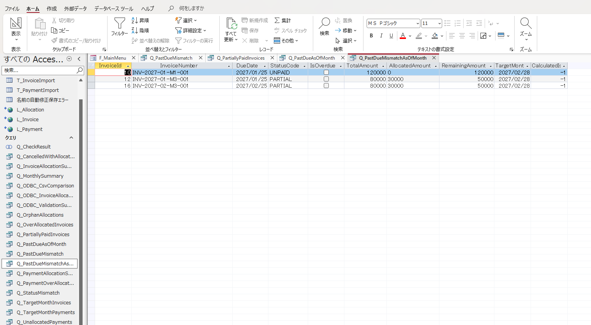
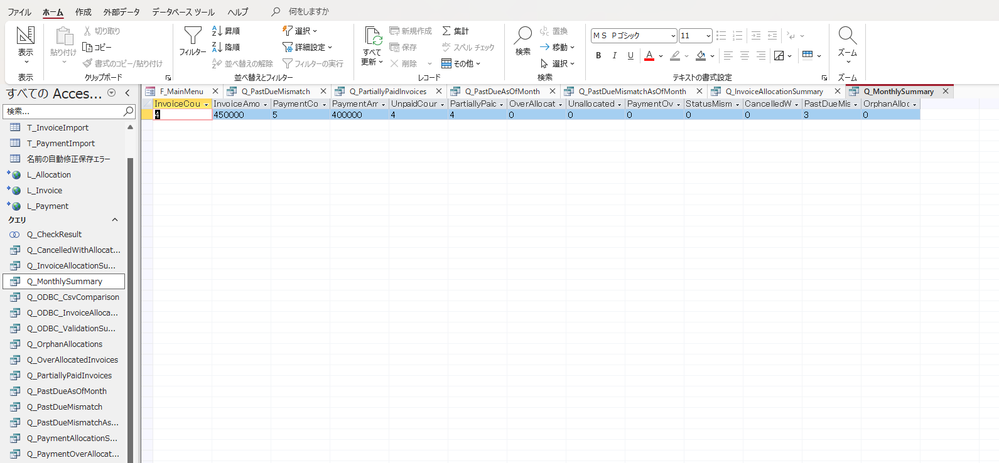
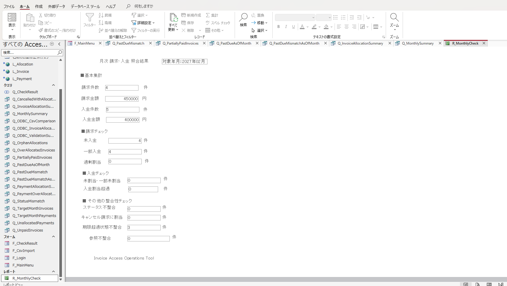

# Phase 4：対象月末基準の期日超過判定改善

> 対象：Invoice Access Operations Tool／Microsoft Access・ローカル検証（2026年10月16日まで）  
> 計算対象：2027年2月のダミー取込データ。Phase 1～3の機能・記録を維持し、`Q_PastDueMismatch` の固定日付依存を別経路で改善した。

## 1. 背景・目的

Phase 3で検証した `Q_PastDueMismatch` は以下の固定日付を使用する。

```sql
DueDate < #2026/10/01#
```

CSVのダミー請求が2026年11月～2027年2月まで含まれる一方、この基準日では初期状態から5件の不一致が検出された。Phase 3の「5件→6件→5件」は検出SQLの機能確認であり、期日判定の業務妥当性を示すものではない。

Phase 4では対象年月から対象月末を求め、**期限超過の計算結果とInvoice由来の `IsOverdue` を併記し、差異を確認候補として抽出**する。旧クエリの結果は履歴・比較用に維持する。

## 2. 実装範囲とフロー

```text
TempVars(TargetYear=2027, TargetMonth=2)
  ↓
Q_InvoiceAllocationSummary
  ↓
Q_PastDueAsOfMonth              ← 全対象請求を月末基準で再計算
  ↓
Q_PastDueMismatchAsOfMonth      ← 登録IsOverdueとの差異のみ
  ↓
Q_MonthlySummary                ← PastDueMismatchCount
  ↓
R_MonthlyCheck                  ← 月次レポート表示
```

旧 `Q_PastDueMismatch` は変更せず、Phase 3の比較用として保存している。

| オブジェクト | 区分 | 変更内容 |
|---|---|---|
| `Q_PastDueAsOfMonth` | 新規 | 月末基準の計算と一覧表示 |
| `Q_PastDueMismatchAsOfMonth` | 新規 | 不一致の抽出 |
| `Q_MonthlySummary` | 既存 | 新しい不一致件数に参照変更 |
| `R_MonthlyCheck` | 既存 | 集計クエリ経由で新件数を表示 |
| `Q_PastDueMismatch` | 既存 | 固定基準日の比較用に残す |

## 3. 判定仕様

### 3.1 対象月末

```text
TargetMonthEnd = DateSerial(TargetYear, TargetMonth + 1, 1) - 1
```

例：2027年2月は2027/02/28。

### 3.2 期限超過候補

```text
StatusCode <> "CANCELLED"
AND InvoiceDate < 翌月1日
AND DueDate < TargetMonthEnd
AND RemainingAmount > 0
```

- **支払期限当日はまだ期限超過ではない**。月末が支払期限なら `DueDate < TargetMonthEnd` はFalse。
- `RemainingAmount` は取込済みPaymentAllocationを再集計した未払残額。
- `IsOverdue` はInvoice側で登録されたステータス由来のフラグであり、**計算値とは異なる属性**。
- `IsOverdue <> CalculatedIsOverdue` の結果は確認候補であり、Invoice側データ不良の確定ではない。

## 4. Access SQL（再現用）

以下のSQLは会話で使用した設計を整理したもので、実 `.accdb` からのクエリ定義エクスポートではない。正式版のSQLビューと突き合わせること。

### 4.1 Q_PastDueAsOfMonth

```sql
SELECT
    Q.InvoiceId,
    Q.MemberId,
    Q.InvoiceNumber,
    Q.InvoiceDate,
    Q.DueDate,
    Q.TotalAmount,
    Q.StatusCode,
    Q.StatusName,
    Q.IsOverdue,
    Q.MemberName,
    Q.AllocatedAmount,
    Q.RemainingAmount,
    DateSerial(
        TempVars!TargetYear,
        TempVars!TargetMonth + 1,
        1
    ) - 1 AS TargetMonthEnd,
    IIf(
        Q.DueDate < DateSerial(
            TempVars!TargetYear,
            TempVars!TargetMonth + 1,
            1
        ) - 1
        AND Q.RemainingAmount > 0,
        True,
        False
    ) AS CalculatedIsOverdue
FROM
    Q_InvoiceAllocationSummary AS Q
WHERE
    Q.StatusCode <> "CANCELLED"
    AND Q.InvoiceDate < DateSerial(
        TempVars!TargetYear,
        TempVars!TargetMonth + 1,
        1
    )
ORDER BY
    Q.InvoiceId;
```

### 4.2 Q_PastDueMismatchAsOfMonth

```sql
SELECT
    Q.InvoiceId,
    Q.InvoiceNumber,
    Q.DueDate,
    Q.StatusCode,
    Q.IsOverdue,
    Q.TotalAmount,
    Q.AllocatedAmount,
    Q.RemainingAmount,
    Q.TargetMonthEnd,
    Q.CalculatedIsOverdue
FROM
    Q_PastDueAsOfMonth AS Q
WHERE
    Q.IsOverdue <> Q.CalculatedIsOverdue
ORDER BY
    Q.InvoiceId;
```

### 4.3 Q_MonthlySummary

以前：

```sql
DCount("*", "Q_PastDueMismatch") AS PastDueMismatchCount
```

変更後：

```sql
DCount("*", "Q_PastDueMismatchAsOfMonth") AS PastDueMismatchCount
```

レポート `R_MonthlyCheck` のレコードソースは引き続き `Q_MonthlySummary`。

## 5. 動作確認

| 確認対象 | 結果 | 判定・補足 |
|---|---|---|
| 対象年月 | 2027年2月 | `TargetMonthEnd=2027/02/28` |
| `Q_PastDueAsOfMonth` | 17件 | 新基準で対象請求を列挙 |
| 旧 `Q_PastDueMismatch` | 5件 | 旧固定基準日の結果、比較用 |
| 新 `Q_PastDueMismatchAsOfMonth` | **3件** | InvoiceId=10, 12, 16 |
| 境界値（日付比較） | 期待結果を確認済みとの開発者報告 | 専用画像なし |
| `Q_MonthlySummary` | **PastDueMismatchCount=3** | 基本集計：請求4件／450,000円、入金5件／400,000円 |
| `R_MonthlyCheck` | **期限超過状態不整合3件** | レポートで正常表示 |

| InvoiceId | DueDate | StatusCode | IsOverdue（登録値） | CalculatedIsOverdue |
|---:|---|---|---|---|
| 10 | 2027/01/25 | UNPAID | False | True |
| 12 | 2027/01/25 | PARTIAL | False | True |
| 16 | 2027/02/25 | PARTIAL | False | True |

旧5件と新3件は**評価日・条件が異なる結果**であり、減少2件分のデータ修正や誤り修復を示さない。

## 6. 月末当日の境界値

以下の読み取り専用SQLで「期限前日True、期限当日False」を確認する方針。開発者から実行成功の報告はあるが、今回提供された5枚に境界値の専用スクリーンショットは含まれない。

```sql
SELECT TOP 1
    DateSerial(2027, 2, 27) < (DateSerial(2027, 3, 1) - 1) AS BeforeMonthEnd,
    DateSerial(2027, 2, 28) < (DateSerial(2027, 3, 1) - 1) AS OnMonthEnd
FROM T_InvoiceImport;
```

期待：`BeforeMonthEnd=-1`、`OnMonthEnd=0`。実際の請求でDueDateが月末ちょうどのケースは今回の17件にはなく、実データを用いた同一条件の境界試験は未実施。

## 7. エビデンス（動確エビデンス20261016.zip）

| ファイル名 | 内容 |
|---|---|
|  | 新不一致抽出の初期表示3件（10,12,16） |
|  | `Q_PastDueAsOfMonth` 全17件と2027/02/28 |
|  | 比較条件調整後の新不一致3件（境界日そのものの証明ではない） |
|  | `Q_MonthlySummary` の不一致3件と基本集計 |
|  | `R_MonthlyCheck` に3件を表示 |

## 8. 制約・残課題

1. **過去時点の完全な再現ではない。** PaymentAllocationの割当日時履歴を持たず、任意の対象月末の正確な割当状態・残額を復元できない。
2. `IsOverdue` は現在のInvoiceステータス由来であり、指定月末の「正しいフラグ」の保証ではない。新3件は確認候補。
3. `Q_PastDueMismatch` はPhase 3の比較資料のために残している。他画面・照合クエリ（例：`Q_CheckResult`）で旧Queryを利用していないかは未点検。
4. `TempVars` が未設定、範囲外の対象月、将来月指定時の入力制限などの運用要件は追加検討。
5. 元データの同一時点性、手動CSV再取込時の取扱い、シード以外の実データでの期日境界試験、本番運用は未実施。

## 9. 関連資料

- [`01_requirements.md`](01_requirements.md) — Phase 4の追加要件（24章）
- [`02_basic_design.md`](02_basic_design.md) — Phase 4の基本設計（47章）
- [`03_detail_design.md`](03_detail_design.md) — Phase 4の詳細SQL・確認手順（73章）
- [`05_phase3_validation.md`](05_phase3_validation.md) — 旧基準日の5件と検証記録
- [`../README.md`](../README.md) — 全体概要と検証エビデンス
